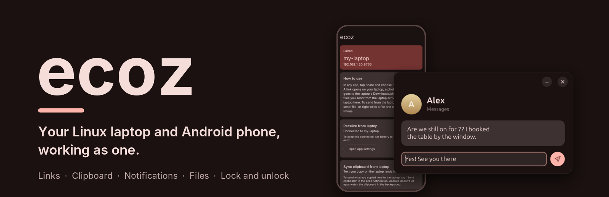
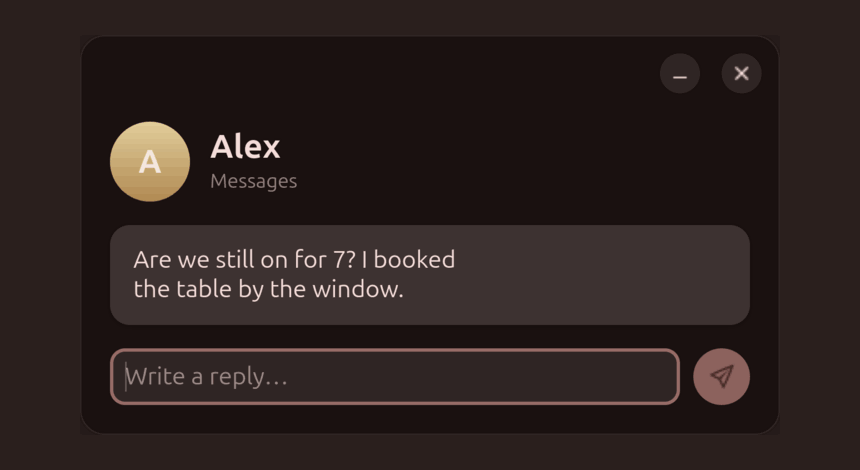
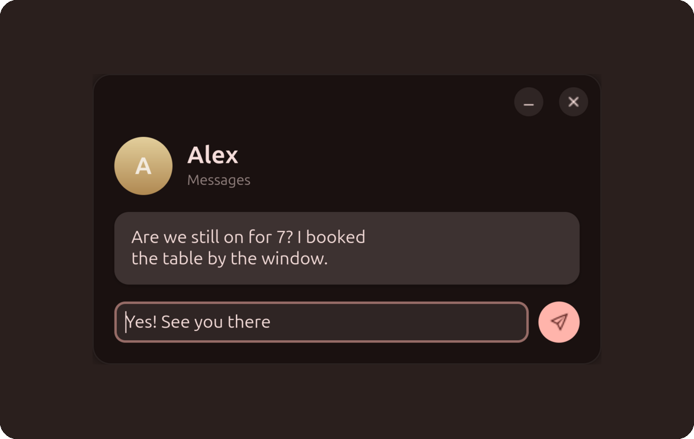
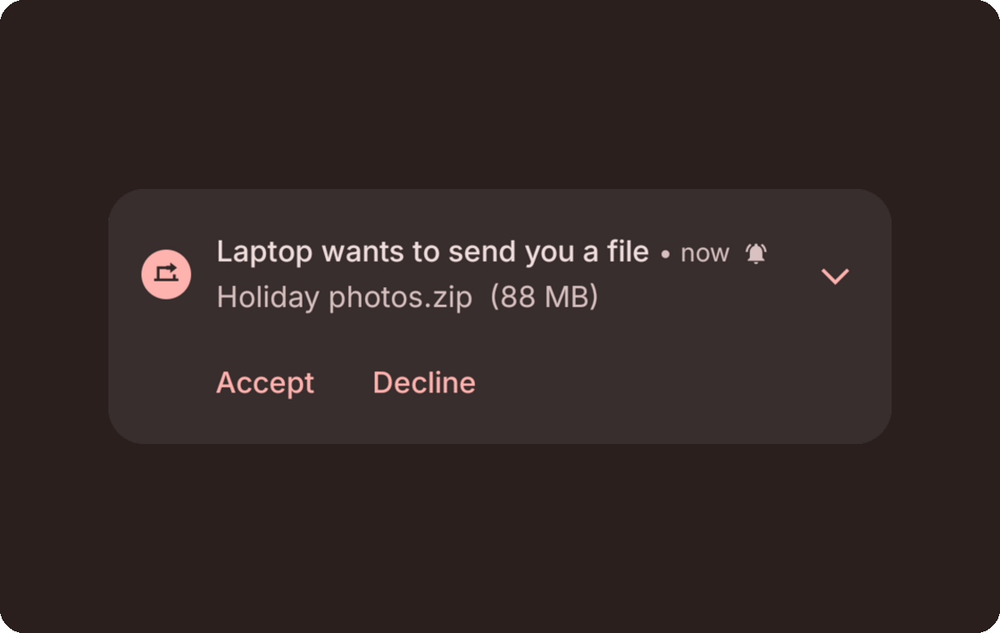
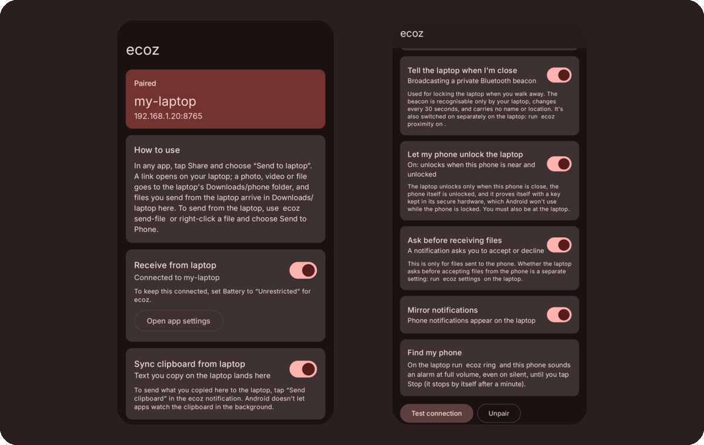
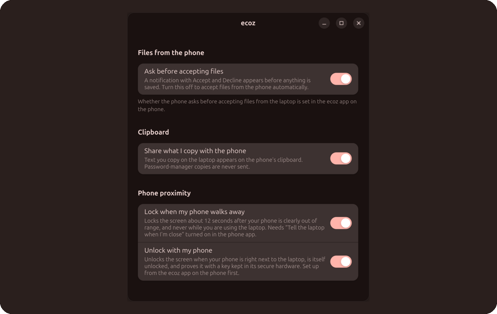

<p align="center">
  
</p>

<p align="center">
  <a href="https://github.com/dakshhpanchal/ecoz/stargazers"></a> <a href="LICENSE"></a> <a href="#requirements"></a> <a href="#requirements"></a> <a href="https://github.com/dakshhpanchal/ecoz/commits/main"></a>
</p>

<p align="center">
  <br>
  <sub>Replying to a message from the laptop. The reply is sent from the phone.</sub>
</p>

ecoz is a small pair of apps, one for a Linux laptop and one for an Android phone, that makes the two behave like parts of the same machine, the way a Mac and an iPhone do. It runs on your own network, with no server in the middle and no account to make.

> **Status: early.** I built and tested it on Ubuntu 26.04 (GNOME 50, Wayland) with a Nothing Phone 3a on Android 16. It works well there. Other setups may need fixes, and [issues and pull requests](#contributing) are welcome.

## What you get

<table>
  <tr>
    <td width="50%" valign="middle"></td>
    <td width="50%" valign="middle">
      <h3>Reply from your keyboard</h3>
      <p>Phone notifications appear on the laptop with the app icon, the sender's photo and the app's own buttons.</p>
      <p><b>Reply</b> opens a small window, and the reply goes out from your phone. Dismiss a notification on the phone and it disappears here. Tested with WhatsApp and Google Messages.</p>
    </td>
  </tr>
  <tr>
    <td width="50%" valign="middle"></td>
    <td width="50%" valign="middle">
      <h3>Files, with a yes or no first</h3>
      <p>Send photos, videos or anything else in both directions. Right-click a file in Files and choose <b>Send to Phone</b>, or share from the phone to <b>Send to laptop</b>.</p>
      <p>Every incoming file shows <b>Accept</b> or <b>Decline</b> before any data moves, and each device has its own switch. About 45 to 55 MB/s over a 5 GHz hotspot.</p>
    </td>
  </tr>
  <tr>
    <td width="50%" valign="middle"></td>
    <td width="50%" valign="middle">
      <h3>A small Android app</h3>
      <p>Share a link to <b>Send to laptop</b> and it opens in your browser. Text you copy on the laptop lands on the phone's clipboard, and one tap on <b>Send Clipboard</b> sends it back.</p>
      <p><code>ecoz ring</code> plays an alarm on the phone at full volume, even on silent.</p>
    </td>
  </tr>
  <tr>
    <td width="50%" valign="middle"></td>
    <td width="50%" valign="middle">
      <h3>Lock when you leave, unlock when you are back</h3>
      <p>The phone sends a private Bluetooth beacon. When it is clearly out of range the laptop locks, and never while you are typing.</p>
      <p>It unlocks only when the phone is close, is itself unlocked, and signs a fresh challenge with a key in its secure hardware. A locked phone cannot unlock the laptop. Both are <b>off</b> until you turn them on.</p>
    </td>
  </tr>
</table>

## How it works

1. **Install** the laptop service (one command) and build the Android app.
2. **Pair** them once with a code. The phone pins the laptop's certificate from then on.
3. **Turn on** what you want from the app and from the laptop's settings window.

The laptop runs a small HTTPS service and the phone keeps one connection open to it, so the laptop can push things to the phone at any time. If the laptop's address changes, the phone finds it again by itself.

```text
Phone (Android app)                                               Laptop (Linux service)
┌───────────────────────────────┐                                 ┌───────────────────────────────┐
│ links, clipboard, files,      │       <=== pinned TLS ===>      │ HTTPS service                 │
│ notifications                 │      over Wi-Fi or hotspot      │ pushes events to the phone    │
├───────────────────────────────┤                                 ├───────────────────────────────┤
│ Bluetooth beacon              │     ..... Bluetooth LE ....>    │ presence scanner              │
│ rotates every 30 s            │                                 │ near / mid / away             │
├───────────────────────────────┤                                 ├───────────────v───────────────┤
│ hardware key                  │    ... signed challenge ...>    │ auto-lock and unlock          │
│ works only if phone unlocked  │                                 │ checks distance + signature   │
└───────────────────────────────┘                                 └───────────────────────────────┘
```

## Requirements

- **Laptop:** Linux with GNOME. Developed on Ubuntu 26.04 (GNOME 50, Wayland). It needs Python 3, PyGObject, `python3-cryptography` (for unlock), OpenSSL, Avahi and BlueZ.
- **Phone:** Android 10 or newer. Developed on Android 16.
- **Network:** both on the same Wi-Fi, or the laptop on the phone's hotspot. Bluetooth is only used for lock and unlock.

## Quick start

### 1. The laptop

```bash
# Debian / Ubuntu package names; adapt for your distro
sudo apt install python3-gi python3-cryptography gir1.2-adw-1 gir1.2-gtk-4.0 \
                 openssl avahi-daemon libnotify-bin xdg-utils

git clone https://github.com/dakshhpanchal/ecoz.git
cd ecoz
./install.sh
```

`install.sh` needs no root. It links the `ecoz` command, starts a systemd user service, and adds a settings launcher and the *Send to Phone* entry in Files. Keep the folder where it is.

**For the shared clipboard**, install the [GSConnect](https://extensions.gnome.org/extension/1319/gsconnect/) GNOME extension and enable it. ecoz only uses its clipboard bridge, so nothing needs to be paired with KDE Connect. On GNOME 50 use **v74 or newer**; older versions hang on it. Without GSConnect, everything else still works.

### 2. The phone

Building needs JDK 17 or newer and the Android SDK (platform 37). Turn on USB debugging to install.

```bash
cd android
./gradlew assembleDebug
adb install -r app/build/outputs/apk/debug/app-debug.apk
```

### 3. Pair them

```bash
ecoz pair
```

This prints a code that starts with `ecoz://`. Get it onto the phone's clipboard any way you like (message it to yourself, for example), then open the app and tap **Paste**, **Pair**, and **Test connection**.

The code contains a secret. Do not post it anywhere public.

### 4. Turn things on

In the app, switch on **Receive from laptop**, and then whichever of **Mirror notifications**, **Tell the laptop when I'm close** and **Let my phone unlock the laptop** you want. On the laptop, open **ecoz** from the app grid (or run `ecoz settings`).

Try it: share a link from Chrome to *Send to laptop*, copy some text on the laptop and paste it on the phone, or run `ecoz ring`.

## Commands

| Command | What it does |
|---|---|
| `ecoz send <link or text>` | Push it to the phone. With no argument, sends your clipboard. |
| `ecoz send-file a.jpg b.pdf` | Offer files to the phone. It asks first, unless you turned that off there. |
| `ecoz ring` / `ecoz ring stop` | Find my phone. |
| `ecoz settings` | The settings window. |
| `ecoz confirm [on\|off]` | Ask before accepting files from the phone (default on). |
| `ecoz sync [on\|off]` | Share the clipboard with the phone. |
| `ecoz proximity [on\|off]`, `ecoz presence` | Listen for the phone's beacon, and show *near*, *mid* or *away* with the signal strength. |
| `ecoz autolock [on\|off]` | Lock when the phone walks away (default off). |
| `ecoz unlock [on\|off\|forget\|status]` | Unlock from the phone (default off). |
| `ecoz pair` | Print the pairing code. |

## Security and privacy

- **Encryption and identity.** Every connection is TLS. The phone pins the laptop's certificate fingerprint when you pair, and the laptop checks a secret token, so a stranger on your Wi-Fi cannot talk to either side.
- **Nothing leaves your network.** No server, no account, no analytics. The phone app only talks to your laptop.
- **Files.** Both directions ask first, before any data moves. Names are reduced to a plain file name, files are written under a temporary name and renamed when complete, and an upload must match what was approved.
- **The beacon.** A tag only your laptop can recognise, changing every 30 seconds, carrying no name or location.
- **Unlock.** It needs the phone near, the phone unlocked, a fresh signed challenge (single use, tied to your laptop, valid for 15 seconds) and someone touching the laptop. The key is created in the phone's secure hardware and cannot be copied out. Registering a phone needs an **Accept** on the unlocked laptop.

Unlock does lower your laptop's protection, so know the limits:

- Someone who can relay your phone's Bluetooth beacon *and* get your unlocked phone to answer could unlock it.
- Anyone who touches the laptop while you stand next to it with an unlocked phone will find it unlocked. Apple's Auto Unlock with a watch works the same way.
- A phone in your pocket is normally locked, so unlock only works while the phone is unlocked. Android's *Extend Unlock* keeps it unlocked while you carry it.

The exact rules are in [`daemon/ecoz_unlock.py`](daemon/ecoz_unlock.py).

## How it compares

ecoz does not replace the mature tools. It aims at one thing: the feel of Apple's Continuity between **one** phone and **one** laptop.

| | ecoz | [KDE Connect](https://kdeconnect.kde.org/) / GSConnect | [LocalSend](https://localsend.org/) |
|---|---|---|---|
| Aim | One phone and one laptop, seamless | Many devices, many plugins | Send files to anyone nearby |
| Lock and unlock with the phone | yes | not that I know of | no |
| Ask before accepting files, per device | yes | not that I know of | no |
| Notification replies | yes | yes | no |
| SMS and calls, media control, remote input | not yet | yes | no |
| Other desktops (KDE, Windows, macOS) | GNOME only for now | yes | yes |
| Maturity | early | many years | many years |

If you want a proven toolbox, use KDE Connect. If you want the unlock and the one-machine feel, try ecoz.

## Limitations

- **GNOME only for now.** The clipboard bridge, locking and idle detection use GNOME. Links, files, notifications and find-my-phone should not depend on it, but I have only tested on GNOME.
- **You build the phone app yourself.** There is no Play Store or F-Droid release yet.
- **Pairing is manual.** There is no QR code yet.
- **Phone to laptop clipboard needs one tap.** Android stops background apps from reading the clipboard. I tried the known workarounds on an Android 16 phone and they do not work there.
- **No SMS yet.** RCS chats cannot be read from the phone by any app, though you can already reply to their notifications.
- **Folders cannot be sent yet,** only files.
- Tested on **one** setup.

## Roadmap

- [x] Links, clipboard, notifications with replies, find my phone
- [x] File transfer both ways, asking first on each device
- [x] Auto-lock and unlock with a hardware-backed key
- [ ] One-tap "turn on hotspot" when the laptop is near and offline
- [ ] QR-code pairing
- [ ] SMS in a laptop window
- [ ] Send folders
- [ ] Release builds: signed APK, F-Droid, `.deb`
- [ ] KDE Plasma and other desktops, X11
- [ ] Browser-tab hand-off, several phones, media controls

Have an idea? [Open an issue](https://github.com/dakshhpanchal/ecoz/issues).

## FAQ

<details><summary><b>Does it need root?</b></summary>

No, neither on the laptop nor on the phone.
</details>

<details><summary><b>Does it work over the internet?</b></summary>

No, by design. Both devices must be on the same Wi-Fi, or the laptop on the phone's hotspot. That also keeps it fast.
</details>

<details><summary><b>Transfers are slow.</b></summary>

Check the Wi-Fi band. On a 2.4 GHz hotspot I measured about 7 MB/s and on 5 GHz about 50 MB/s. Set the phone's hotspot to 5 GHz.
</details>

<details><summary><b>The phone notification says "Connecting" and never connects.</b></summary>

Check the laptop service with `systemctl --user status ecoz`, make sure both are on the same network, and set the app's battery setting to *Unrestricted* so Android does not kill the connection.
</details>

<details><summary><b>How do I uninstall it?</b></summary>

```bash
systemctl --user disable --now ecoz
rm ~/.local/bin/ecoz ~/.config/systemd/user/ecoz.service \
   ~/.local/share/applications/ecoz.desktop "$HOME/.local/share/nautilus/scripts/Send to Phone"
rm -r ~/.config/ecoz        # your certificate, token and settings
```

Then uninstall the app from the phone.
</details>

## Contributing

Bug reports, ideas and pull requests are welcome. Good first things to pick up: QR pairing, KDE Plasma support, packaging, and tests.

```text
daemon/        the laptop side (Python). ecoz_daemon.py is the service and the CLI;
               ecoz_presence, ecoz_lock and ecoz_unlock handle proximity;
               ecoz_reply and ecoz_settings are the GTK 4 and libadwaita windows
android/       the phone app (Kotlin, Jetpack Compose, Material 3)
integrations/  the Files right-click script and the app-grid launcher
```

Run the service from source with `python3 -I daemon/ecoz_daemon.py serve`. If you open a pull request, please try the part you changed on a real device, since most bugs here only show up on real hardware.

## License

[MIT](LICENSE) © 2026 Daksh Panchal

## Thanks

[GSConnect](https://github.com/GSConnect/gnome-shell-extension-gsconnect) and KDE Connect, whose clipboard bridge ecoz uses on GNOME and which showed what a phone and laptop link can be. [LocalSend](https://localsend.org/), for the standard of how simple local file sharing should feel.
