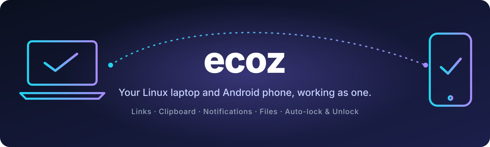
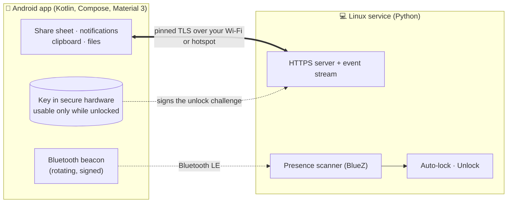

<p align="center">
  
</p>

<p align="center">
  <a href="https://github.com/dakshhpanchal/ecoz/stargazers"></a>
  <a href="https://github.com/dakshhpanchal/ecoz/commits/main"></a>
  
  <a href="LICENSE"></a>
</p>
<p align="center">
  
  
  
  
</p>

<p align="center">
  <b>Tap a link on your phone and it opens on your laptop. Copy on the laptop and paste on the phone.<br>
  Reply to messages from your keyboard. Walk away and the laptop locks. Sit down and it unlocks.</b><br>
  <sub>Open source, no cloud, no account: your two devices talk directly, over your own network.</sub>
</p>

---

## ✨ What you get

| | Feature | How it works |
|---|---|---|
| 🔗 | **Open links on the laptop** | Share anything from the phone → **Send to laptop**. |
| 📋 | **Shared clipboard** | What you copy on the laptop lands on the phone automatically. On the phone, one tap on **Send Clipboard** sends it back. |
| 🔔 | **Phone notifications on the laptop** | With the app icon, the sender's photo and the app's own buttons. **Reply** from a small native window. Tested with **WhatsApp** and **Google Messages**; any app that puts a reply box in its notification should work too. Dismiss on the phone and it disappears here. |
| 📁 | **Fast file transfer, both ways** | Photos, videos, anything, to `~/Downloads/phone` or the phone's `Download/laptop`. Right-click in Files → **Send to Phone**. About **45–55 MB/s** measured over a 5 GHz hotspot. |
| 🛡️ | **Asks before it accepts anything** | Every incoming file triggers an **Accept / Decline** prompt. Each device has its **own** switch, so you can ask on one side and not the other. |
| 📍 | **Find my phone** | `ecoz ring` plays an alarm at full volume, even on silent. |
| 🔒 | **Locks when you walk away** | A private Bluetooth beacon tells the laptop when your phone leaves. It never locks while you're typing. |
| 🔓 | **Unlocks when you're back** | Only if the phone is **close, unlocked and proves itself** with a key in its secure hardware. A locked phone cannot unlock it. |

Everything is **opt-in where it matters** (lock and unlock are off until you turn them on), and nothing ever leaves your local network.

> **Honest status:** ecoz is young and built for one setup (Ubuntu 26.04 · GNOME 50 · Wayland and a Nothing Phone 3a on Android 16). It works well there; other setups may need tweaks. [Issues and PRs are very welcome.](#-contributing)

---

## 🚀 Quick start

You need a **Linux laptop running GNOME** and an **Android 10+ phone**, on the same Wi-Fi or the phone's hotspot.

### 1. The laptop

```bash
# Debian / Ubuntu package names; adapt for your distro
sudo apt install python3-gi python3-cryptography gir1.2-adw-1 gir1.2-gtk-4.0 \
                 openssl avahi-daemon libnotify-bin xdg-utils

git clone https://github.com/dakshhpanchal/ecoz.git
cd ecoz
./install.sh
```

`install.sh` needs no root. It links the `ecoz` command, starts a user service, and adds a settings launcher and the Files right-click entry. Keep the folder where it is.

**For the shared clipboard**, install the [GSConnect](https://extensions.gnome.org/extension/1319/gsconnect/) GNOME extension and enable it. ecoz borrows only its clipboard bridge, so you do **not** have to pair anything with KDE Connect. On GNOME 50 use **v74 or newer**: older versions hang on it. Without GSConnect everything else still works.

### 2. The phone

You'll need JDK 17+ and the Android SDK (platform 37) to build, and USB debugging on to install.

```bash
cd android
./gradlew assembleDebug
adb install -r app/build/outputs/apk/debug/app-debug.apk
```

### 3. Pair them

```bash
ecoz pair
```

It prints a code that starts with `ecoz://`. Get it onto the phone's clipboard any way you like (message it to yourself, a notes app, anything), then open the **ecoz** app → **Paste** → **Pair** → **Test connection**.

> 🔐 The pairing code contains your secret. Don't post it anywhere public.

### 4. Switch on what you want

In the app, turn on **Receive from laptop** (links, clipboard, files, ring) and, if you like, **Mirror notifications**, **Tell the laptop when I'm close** and **Let my phone unlock the laptop**. On the laptop open **ecoz** from your app grid (or run `ecoz settings`) for the laptop-side switches.

**Try it:** share a link from Chrome → *Send to laptop*. Copy some text on the laptop and paste it on the phone. Run `ecoz ring`.

---

## 🧰 Commands

| Command | What it does |
|---|---|
| `ecoz send <link or text>` | Push it to the phone. With no argument, sends your clipboard. |
| `ecoz send-file a.jpg b.pdf` | Offer files to the phone (it asks first, unless you turned that off there). |
| `ecoz ring` &nbsp;/&nbsp; `ecoz ring stop` | Find my phone. |
| `ecoz settings` | Settings window: ask-before-accepting, clipboard sharing, auto-lock, unlock. |
| `ecoz confirm [on\|off]` | Ask before accepting files from the phone (default **on**). |
| `ecoz sync [on\|off]` | Clipboard sharing with the phone. |
| `ecoz proximity [on\|off]` · `ecoz presence` | Listen for the phone's beacon · show **NEAR / MID / AWAY** and the signal strength. |
| `ecoz autolock [on\|off]` | Lock the laptop when the phone walks away (default **off**). |
| `ecoz unlock [on\|off\|forget\|status]` | Unlock from the phone (default **off**). |
| `ecoz pair` | Print the pairing code. |

---

## 🔧 How it works



- The laptop runs a small **HTTPS service**. The phone keeps one connection open to it, so the laptop can push links, clipboard changes, files and unlock challenges to the phone at any time.
- The phone **finds the laptop again by itself** through mDNS if its address changes.
- **No cloud in the middle.** The two ends talk directly: the phone pins the laptop's certificate, and the laptop checks a secret token.
- Written in plain Python (standard library plus PyGObject, and `cryptography` for unlock) and Kotlin, with no heavy frameworks.

---

## 🔐 Security and privacy

| | |
|---|---|
| **Encryption and identity** | Every connection is TLS. The phone **pins** the laptop's certificate fingerprint at pairing, and the laptop checks a secret token. A stranger on your Wi-Fi cannot talk to it. |
| **Nothing leaves your network** | No server, no account, no analytics. The phone app only talks to your laptop. |
| **Files** | Both directions ask first, **before any data moves**. Names are reduced to a plain base name, files are written under a temporary name and renamed when complete, and an approved upload must match what was approved. |
| **The beacon** | A tag that only your laptop can recognise, **rotating every 30 seconds**, with no name or location. It can't be used to track you. |
| **Unlock** | Needs the phone near **and** unlocked **and** a fresh signed challenge (single use, bound to your laptop, expires in 15 s) **and** someone touching the laptop. The key is created in the phone's secure hardware and can't be copied out. Registering a phone requires an **Accept** on the unlocked laptop. |

**Know the limits.** Unlock lowers your laptop's protection:

- Someone who can **relay** your phone's Bluetooth beacon *and* get your unlocked phone to answer could unlock it.
- Anyone who touches the laptop while you stand next to it with an unlocked phone will find it unlocked. (Apple's Auto Unlock with a watch works the same way.)
- A phone in your pocket is normally locked, so it only works while the phone is unlocked. Android's **Extend Unlock** keeps it unlocked while you carry it.

Lock and unlock are **off by default**. See [`daemon/ecoz_unlock.py`](daemon/ecoz_unlock.py) for the exact rules.

---

## ⚖️ How it compares

ecoz is **not** a replacement for the mature tools. It aims at a different goal: the *Apple Continuity feel* between **one** phone and **one** laptop.

| | ecoz | [KDE Connect](https://kdeconnect.kde.org/) / GSConnect | [LocalSend](https://localsend.org/) |
|---|---|---|---|
| Goal | One phone ↔ one laptop, seamless | Many devices, many plugins | Send files to anyone nearby |
| Lock when the phone walks away, unlock when it's back | ✅ | – | – |
| Ask before accepting files, a separate setting per device | ✅ | – | – |
| Notification replies | ✅ | ✅ | – |
| SMS / calls, media control, remote input | ❌ not yet | ✅ | – |
| Other desktops (KDE, Windows, macOS) | ❌ GNOME only for now | ✅ | ✅ |
| Maturity | 🌱 early | 🌳 many years | 🌳 many years |

<sub>"–" means not a feature I'm aware of. Corrections welcome.</sub>

If you want a battle-tested toolbox, use KDE Connect. If you want the unlock and the "it just feels like one device" parts, try ecoz.

---

## 🚧 Limitations

- **GNOME only for now.** The clipboard bridge, locking and idle detection use GNOME. (Links, files, notifications and find-my-phone don't depend on it, but I've only tested on GNOME.)
- **The phone app is a debug build you compile yourself.** No Play Store or F-Droid release yet.
- **Pairing is manual:** there's no QR code yet.
- **Phone → laptop clipboard needs one tap.** Android stops background apps from reading the clipboard, so it can't be fully automatic. I tried the known workarounds on an Android 16 phone and they don't work there.
- **No SMS yet**, and RCS chats can't be read from the phone by any app, though you can already **reply to their notifications**.
- **Folders can't be sent yet**, only files.
- Tested on **one** setup. Expect rough edges elsewhere.

---

## 🗺️ Roadmap

- [x] Links · clipboard · notifications with replies · find my phone
- [x] File transfer in both directions, with ask-first on each device
- [x] Auto-lock · unlock with a hardware-backed key
- [ ] **One-tap "turn on hotspot" when the laptop is near and offline**
- [ ] **QR-code pairing**
- [ ] SMS in a laptop window
- [ ] Send folders (zip on the fly)
- [ ] Packaged releases: signed APK, F-Droid, `.deb`
- [ ] KDE Plasma and other desktops · X11
- [ ] Browser-tab hand-off · several phones · media controls

Got an idea? [Open an issue](https://github.com/dakshhpanchal/ecoz/issues).

---

## ❓ FAQ

<details><summary><b>Does it need root?</b></summary>
No, neither on the laptop nor on the phone.
</details>

<details><summary><b>Does it work over the internet?</b></summary>
No, by design. Both devices must be on the same Wi-Fi, or the laptop on the phone's hotspot. It's also faster that way (about 50 MB/s on 5 GHz).
</details>

<details><summary><b>Why is transfer slow for me?</b></summary>
Check the band. On a 2.4 GHz hotspot I measured about 7 MB/s, and about 50 MB/s on 5 GHz. Switch the phone's hotspot to 5 GHz.
</details>

<details><summary><b>The notification on my phone says "Connecting…" forever.</b></summary>
Check the laptop service: <code>systemctl --user status ecoz</code>. Make sure the phone is on the same network, and set the app's battery setting to <b>Unrestricted</b> so Android doesn't kill the connection.
</details>

<details><summary><b>How do I uninstall it?</b></summary>

```bash
systemctl --user disable --now ecoz
rm ~/.local/bin/ecoz ~/.config/systemd/user/ecoz.service \
   ~/.local/share/applications/ecoz.desktop "$HOME/.local/share/nautilus/scripts/Send to Phone"
rm -r ~/.config/ecoz        # your certificate, token and settings
```
Then uninstall the app from the phone.
</details>

---

## 🤝 Contributing

Pull requests, bug reports and ideas are very welcome. Good first things to pick up: **QR pairing**, **KDE Plasma support**, **packaging**, and **tests**.

```text
daemon/        laptop side (Python): ecoz_daemon.py is the service and CLI;
               ecoz_presence / ecoz_lock / ecoz_unlock handle proximity;
               ecoz_reply / ecoz_settings are the GTK 4 + libadwaita windows
android/       phone app (Kotlin, Jetpack Compose, Material 3)
integrations/  Files right-click script and the app-grid launcher
```

Run the service from source with `python3 -I daemon/ecoz_daemon.py serve`. When you open a PR, please test the part you changed on a real device. Most bugs here only show up on real hardware.

---

## 🙏 Thanks

- [GSConnect](https://github.com/GSConnect/gnome-shell-extension-gsconnect) / KDE Connect, whose clipboard bridge ecoz uses on GNOME, and which showed what a phone-and-laptop link can be.
- [LocalSend](https://localsend.org/), for the standard of how simple local file sharing should feel.

## 📄 License

[MIT](LICENSE) © 2026 Daksh Panchal. Use it, change it, share it.

<p align="center">
  <br>
  If ecoz makes your phone and laptop feel like one device, a ⭐ helps other people find it.
</p>
